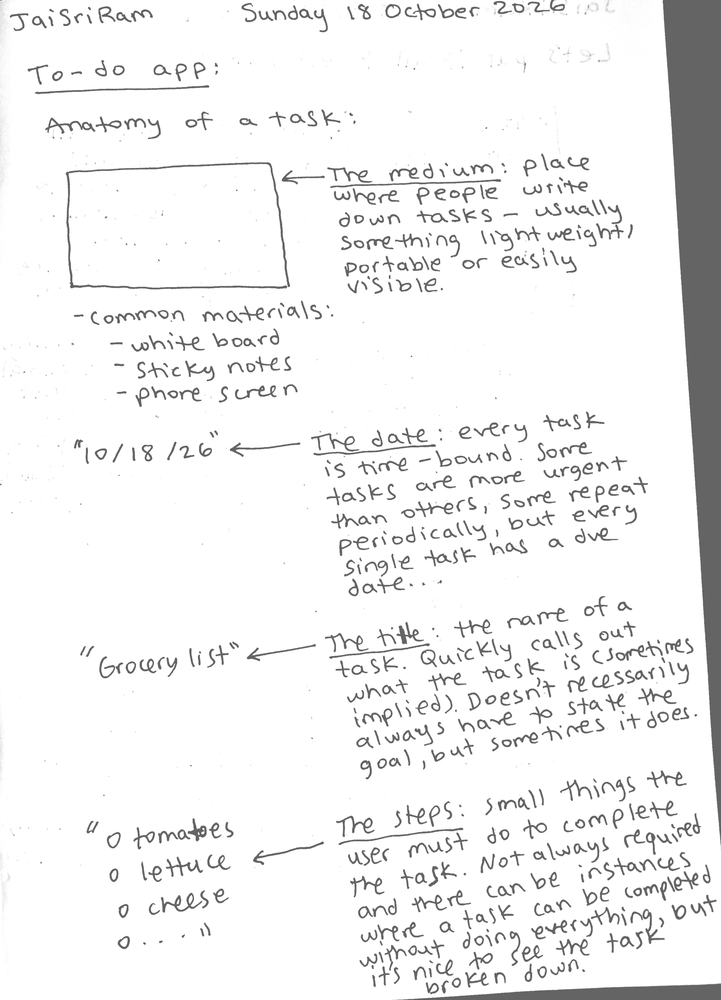
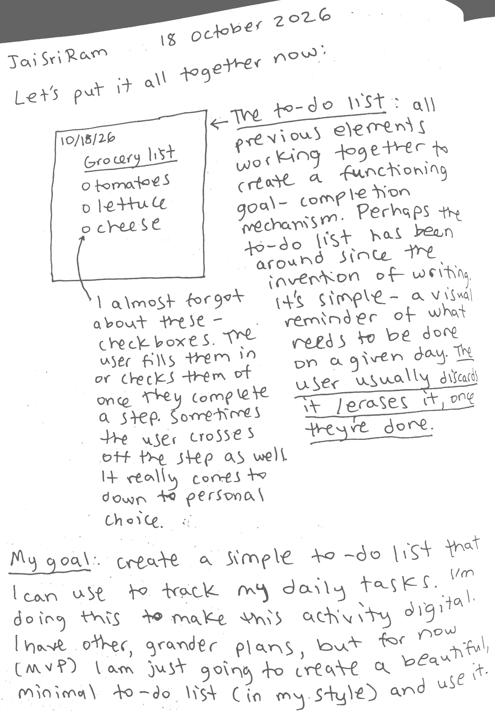

Jai Sri Ram
Date: Sunday 18 October 2026
Author: Shashank Kaveti

Going forward, I want to start from here. I've spent some time aways and I have been thinking about how I want to approach this app and the things I want to do with it. I will admit that I was trying to do too much and had a messy vision for V0 and V1. This is my attempt to create it in a more structured way and build it with clearer vision. I may make mistakes along the way (like I did for the previous versions), but I will learn from them and document everything.

MVP scope:
- simple, minimal to-do app
- here's what it should do:
    - display 9 taks
    - each task should have a maximum of 9 steps
    - if the user completes all steps, then the task is completed
    - a task can also be completed if none of the steps are completed
    - all task history is stored in a local database
    - tasks also display a deadline (date)
    - user can create/edit/delete tasks
    - completed tasks are shown in the UI as well

Vision:
This will be a simple web app that will digitize the to-do list I currently maintain in my notebook. There's no AI integration, nothing fancy (for now). It's as simple and straightforward as it sounds. I'll add more as more ideas pop into my head, but this is the vision for the MVP- a simple, beautiful, and minimal to-do list (done my way).

Notes:

